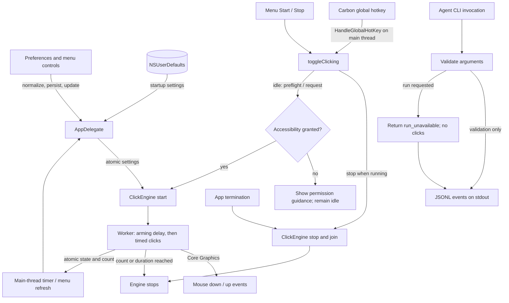

# Architecture and event flow

SymClick is a native macOS menu-bar application. AppKit owns the interface,
Carbon delivers the registered global shortcut, and a C++ worker posts mouse
events through Core Graphics. The current implementation lives in
[`src/main.mm`](../src/main.mm).

## Menu-bar lifecycle

1. [`applicationDidFinishLaunching:`](../src/main.mm#L684) registers defaults,
   loads and normalizes settings, configures its `ClickEngine`, builds the menu,
   installs the hotkey, and starts a 100 ms status timer. Settings actions write
   preferences and update the engine's atomic fields.
2. [`HandleGlobalHotKey`](../src/main.mm#L673) forwards the registered Carbon
   hotkey to [`toggleClicking:`](../src/main.mm#L894) on the main thread. The menu
   action calls the same method. A running or arming menu-bar engine is stopped
   before any permission check; an idle engine checks Accessibility and may
   request access. A refusal displays guidance and does not start a run.
3. [`ClickEngine::start`](../src/main.mm#L397) marks the engine running, resets its
   count and starts the worker. [`ClickEngine::run`](../src/main.mm#L474) creates an
   event source, waits through the optional arming delay, then schedules logical
   clicks using `mach_absolute_time`. Click-count and duration limits stop a run;
   repeat mode continues until stopped.
4. [`ClickEngine::stop`](../src/main.mm#L406) clears the running and arming flags and
   joins the worker. The worker checks the running flag between waits, which are
   capped at approximately 5 ms; this cap is not a measured end-to-end latency
   guarantee. App termination also stops the engine.
5. [`pollEngine:` and `updateUI`](../src/main.mm#L1031) read engine state on the main
   thread to display idle, starting, or clicking and the current logical count.
   `menuWillOpen:` refreshes the display immediately as the menu opens.

The worker uses atomic values for settings and state read across threads. A
logical double click emits two down/up pairs with different click-state metadata;
the reported count tracks logical clicks, not individual mouse events.

## Agent process boundary

`main` dispatches agent arguments before starting AppKit. `RunAgentCommand`
validates arguments and the dry-run path emits a plan without clicking. Agent
execution fails closed with `run_unavailable`: the menu-bar shortcut and status
cannot yet stop or observe a separate CLI engine. Inspection and validation are
available; see [`AGENT_INTEGRATION.md`](AGENT_INTEGRATION.md) for the contract.

## Maintaining this document

When changing hotkeys, Accessibility checks, engine state, threading, event
generation, termination, or agent behavior, review the diagram and linked
symbols against the source. Update the diagram and the relevant lifecycle text
in the same pull request. Run the checks in [`CONTRIBUTING.md`](../CONTRIBUTING.md)
and describe any manual validation and safety implications in the PR.
